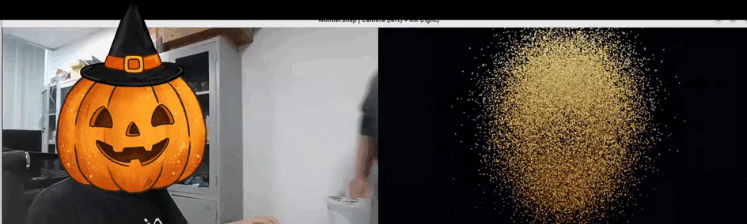

# WonderSnap

**Real-time hand-gesture-controlled 3D particle AR with Python, MediaPipe, and ModernGL.**

WonderSnap is a webcam-based creative coding project that turns hand gestures into interactive, glowing 3D particle effects. It tracks hand landmarks in real time and uses GPU rendering to animate procedural point clouds representing recognizable landmarks.

## Demo

The animation below is the project demo. GitHub displays the GIF directly in this README, so visitors can see the result without downloading or running the project.



## Features

- **Real-time hand tracking** using MediaPipe hand landmarks.
- **Gesture-driven interaction** for opening, closing, and triggering a snap effect.
- **Procedural 3D point clouds** for Big Ben, the Giza pyramids, Thap Rua (Turtle Tower), and the Statue of Liberty.
- **Particle morphing** with swirling transitions between landmark models.
- **GPU-based rendering** with ModernGL and GLSL, including additive blending and glow-like effects.
- **Webcam background** rendered as a texture in the OpenGL scene.
- **Adjustable appearance and performance** through `config.yaml`, including particle count, smoothing, palette, and camera settings.
- **FPS and interaction status** shown in the application window.

## Tech stack

| Component | Technology |
| --- | --- |
| Language | Python |
| Hand tracking | MediaPipe |
| Camera input and image processing | OpenCV |
| Numerical operations and point-cloud generation | NumPy |
| GPU rendering and shaders | ModernGL, OpenGL, GLSL |
| Window and OpenGL context | GLFW |
| Configuration | YAML / PyYAML |

## Requirements

- Python 3.10 (recommended)
- A working webcam
- An OpenGL-capable graphics driver
- Ubuntu/Linux is the documented setup environment

## Installation

Clone the repository and enter its directory:

```bash
git clone https://github.com/<your-username>/WonderSnap.git
cd WonderSnap
```

Create and activate a virtual environment. With Conda:

```bash
conda create -n wondersnap python=3.10 -y
conda activate wondersnap
```

Install the dependencies:

```bash
pip install -r requirements.txt
```

On Ubuntu, if GLFW or OpenGL system libraries are missing, install them with:

```bash
sudo apt update
sudo apt install libglfw3 libgl1-mesa-glx
```

Start the application:

```bash
python app.py
```

If the webcam is not detected correctly, run the camera diagnostic:

```bash
python check_camera.py
```

## Gestures

- **Open hand:** expands the current landmark into a glowing energy effect.
- **Fist after opening:** reassembles the effect into the next landmark.
- **Snap gesture:** triggers a shockwave and advances to the next landmark.

Gesture thresholds, stability frames, and cooldown timing can be tuned in `config.yaml`.

## Keyboard controls

| Key | Action |
| --- | --- |
| `Q` or `Esc` | Quit |
| `1`–`4` | Select a landmark directly |
| `Space` | Trigger the snap effect manually |
| `F` | Force fist state |
| `O` | Force open-hand state |
| `R` | Reset the scene |
| `P` | Cycle the color palette |
| `+` / `-` | Increase / decrease object scale |
| `C` | Toggle centered / hand-following placement |
| `S` | Toggle fixed size / hand-size-based scaling |
| `B` | Toggle webcam background behind the result |
| `K` | Toggle hand-keypoint debugging |

## Configuration

Most runtime settings are in `config.yaml`:

- `camera`: camera index, resolution, frame rate, and automatic camera selection.
- `particles`: particle count, point size, damping, and morph transition settings.
- `tracking`: MediaPipe complexity, tracking resolution, and smoothing.
- `gesture`: gesture thresholds and snap cooldown.
- `render`: palette, glow strength, object scale, placement, and background options.

For performance tuning, start with the configured particle count and increase it gradually based on your GPU and target frame rate.

## Project structure

```text
WonderSnap/
├── hand/
│   ├── gesture.py
│   └── tracker.py
├── particles/
│   ├── point_cloud.py
│   └── system.py
├── renderer/
│   └── renderer.py
├── scene/
│   └── scene_manager.py
├── app.py
├── check_camera.py
├── config.yaml
├── requirements.txt
├── wondersnap.gif
└── README.md
```

## Scope and limitations

WonderSnap is a **screen-space webcam AR prototype**, not a metric 3D reconstruction or world-anchored AR system. The visual effect is positioned using camera-space hand tracking rather than calibrated real-world coordinates.

## License

No license file is included yet. Add a `LICENSE` file before publishing if you want to specify how others may use, modify, or redistribute this project.
